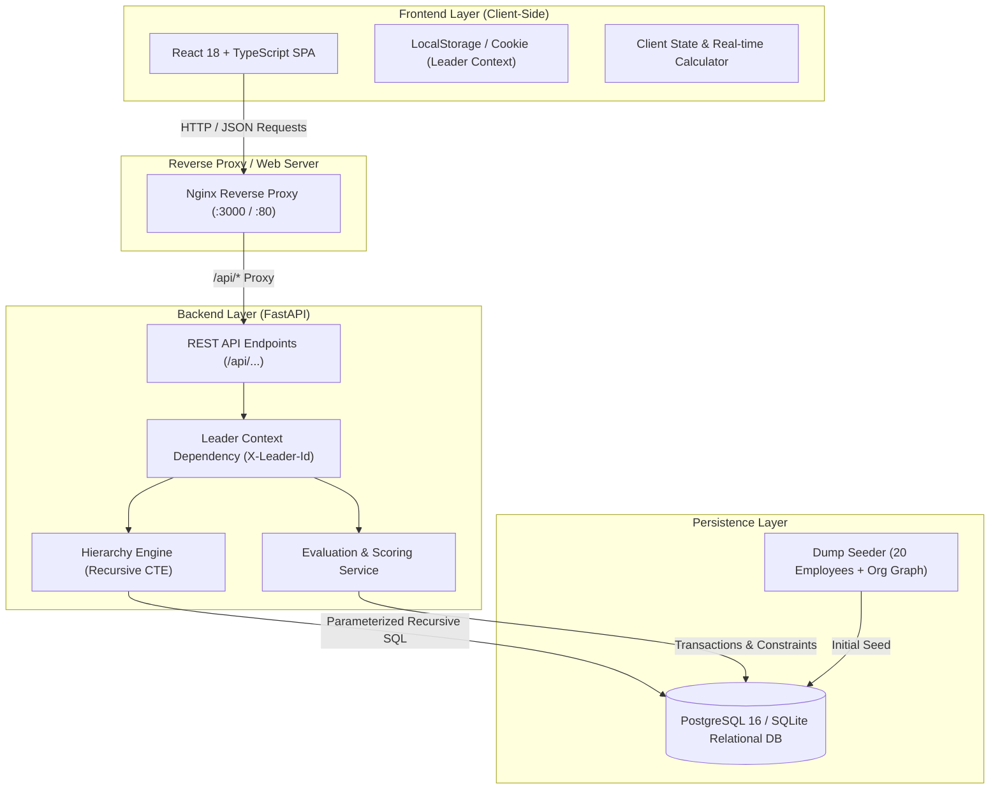
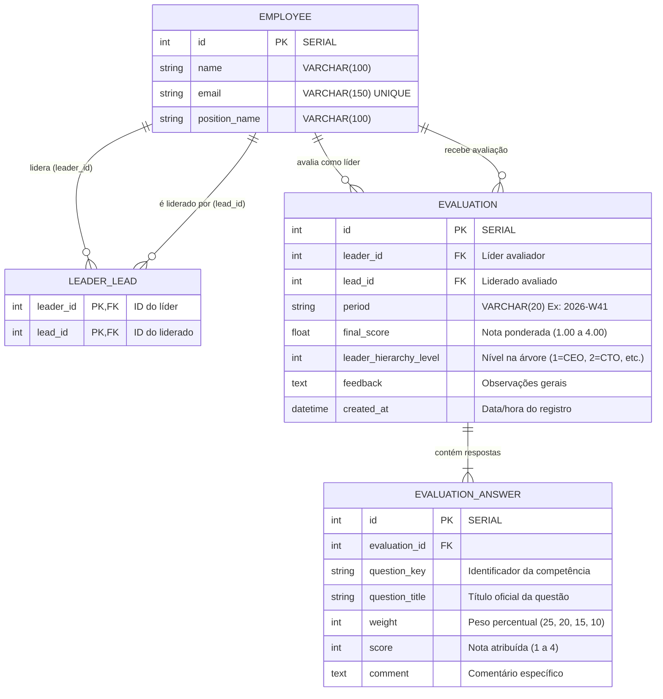

# Arquitetura e Engenharia do Sistema

Este documento descreve as decisões de arquitetura, modelagem de dados, algoritmos de resolução hierárquica e estratégias de segurança implementadas na **Plataforma de Avaliação de Liderados**.

---

## 1. Visão Geral da Arquitetura

O sistema adota uma arquitetura em camadas desacopladas (**Layered Architecture**), orientada a serviços e APIs RESTful, garantindo alta coesão, baixo acoplamento e manutenibilidade.



---

## 2. Modelo de Dados Relacional (ERD)

O banco de dados armazena os colaboradores, as relações hierárquicas auto-referenciadas de liderança e as avaliações com respostas decompostas e pesos institucionais.



### Constraints e Regras no Banco:
1. `chk_no_self_lead`: Impede que um funcionário lidere a si mesmo (`leader_id <> lead_id`).
2. `uq_leader_lead_period`: Constraint de unicidade na tabela `evaluation` para a tupla `(leader_id, lead_id, period)`. Garante a nível de banco que nenhum líder possa avaliar o mesmo colaborador mais de uma vez na mesma semana.
3. Chaves estrangeiras com `ON DELETE CASCADE` preservando integridade referencial.

---

## 3. Resolução da Hierarquia: Common Table Expressions (CTE)

Para atender ao requisito de que **o líder avalia todos os funcionários da sua hierarquia (diretos e indiretos)** sem sofrer com problemas de *N+1 queries*, foi utilizado um **Common Table Expression (CTE) recursivo padrão ANSI SQL**.

### 3.1. Query Parametrizada de Subordinados Diretos e Indiretos:
```sql
WITH RECURSIVE sub_tree AS (
    -- Caso Base: Subordinados Diretos (Profundidade 1)
    SELECT 
        ll.lead_id,
        1 AS depth,
        ll.leader_id AS direct_leader_id
    FROM leader_lead ll
    WHERE ll.leader_id = :leader_id
    
    UNION ALL
    
    -- Passo Recursivo: Subordinados dos Subordinados (Indiretos)
    SELECT 
        ll.lead_id,
        st.depth + 1,
        ll.leader_id AS direct_leader_id
    FROM leader_lead ll
    JOIN sub_tree st ON ll.leader_id = st.lead_id
)
SELECT 
    st.lead_id,
    MIN(st.depth) AS depth,
    st.direct_leader_id
FROM sub_tree st
GROUP BY st.lead_id, st.direct_leader_id
ORDER BY depth ASC, st.lead_id ASC;
```

### 3.2. Cálculo do Nível Hierárquico Organizacional:
O nível de senioridade na árvore corporativa é calculado dinamicamente:
- **Nível 1**: Topo da organização / CEO (Alice Hartman - sem superiores).
- **Nível 2**: Reportes diretos do CEO (Bob Sinclair - CTO, Carol Nguyen - CFO, Frank Rossi - PM, Tina - HR).
- **Nível 3**: Gerentes e Especialistas (David Okafor - Eng Mgr, Eva Müller - Eng Mgr, etc.).
- **Nível 4**: Engenheiros Seniores (Henry Patel, Liam Johansson, etc.).
- **Nível 5**: Engenheiros Plenos e Juniores (James Watanabe, Karen Oliveira).

Quanto **menor o número**, **maior é a posição hierárquica**.

---

## 4. Princípio da Prevalência por Maior Hierarquia

> **Requisito Oficial:** *"Os líderes podem avaliar seus liderados diretos e os liderados dos seus subordinados, mesmo que seu subordinado já tenha avaliado o seu próprio liderado dentro do período. As respostas cadastradas quando o funcionário já tenha sido avaliado (respeitando sempre a maior hierarquia)."*

### Cenário de Exemplo Real:
Na Semana `2026-W41`:
1. **Henry Patel** (Senior Software Engineer, Nível 4) avalia **James Watanabe** com nota **3.30**.
2. **David Okafor** (Engineering Manager, Nível 3 - superior de Henry) também avalia **James Watanabe** na mesma semana com nota **3.65**.
3. **Bob Sinclair** (CTO, Nível 2 - superior de David) também avalia **James Watanabe** com nota **4.00**.

### Algoritmo de Prevalência:
```python
# Ordenação pelo nível hierárquico ascendente (1 > 2 > 3 > 4) e desempate por created_at mais recente
prevailing_eval = min(
    evaluations_for_period,
    key=lambda e: (e.leader_hierarchy_level, -e.created_at.timestamp())
)
```
- A avaliação de **Bob Sinclair (CTO, Nível 2)** prevalece sobre a de David (Nível 3) e Henry (Nível 4).
- No frontend e nos relatórios, a nota de Bob é exibida com a insígnia oficial `🏆 Avaliação Prevalente (Maior Hierarquia: Bob Sinclair - CTO)`.
- O histórico mantém o registro íntegro de **todas** as avaliações realizadas, permitindo auditoria completa.

---

## 5. Política e Matriz de Segurança & Visibilidade

O sistema segue o princípio do menor privilégio (**Least Privilege**).

| Colaborador Alvo | Visualização pelo Usuário Ativo | Avaliação pelo Usuário Ativo | Justificativa / Regra |
| :--- | :---: | :---: | :--- |
| **Próprio Usuário** | ❌ **PROIBIDO (403)** | ❌ **PROIBIDO (400)** | Vedado ao usuário ver a sua própria avaliação ou autoavaliar-se. |
| **Pares** (Mesmo nível / mesmo líder) | ❌ **PROIBIDO (403)** | ❌ **PROIBIDO (403)** | Vedado ver avaliações de pares. |
| **Superiores** (Líderes na cadeia ascendente) | ❌ **PROIBIDO (403)** | ❌ **PROIBIDO (403)** | Vedado ver avaliações de líderes/superiores. |
| **Outras áreas** (Fora da árvore) | ❌ **PROIBIDO (403)** | ❌ **PROIBIDO (403)** | Sem relação de hierarquia direta ou indireta. |
| **Subordinado Direto** | ✅ **PERMITIDO (200)** | ✅ **PERMITIDO (201)** | Faz parte da hierarquia imediata. |
| **Subordinado Indireto** | ✅ **PERMITIDO (200)** | ✅ **PERMITIDO (201)** | Faz parte da cadeia descendente de comando. |

---

## 6. Fórmula de Ponderação e Perguntas Institucionais

As perguntas e seus pesos percentuais oficiais somam 100%:

$$\text{Nota Final} = \frac{(25 \times Q_1) + (20 \times Q_2) + (20 \times Q_3) + (15 \times Q_4) + (10 \times Q_5) + (10 \times Q_6)}{100}$$

Onde $Q_i \in \{1, 2, 3, 4\}$.
A nota final resultante varia estritamente no intervalo fechado $[1.00, 4.00]$.
