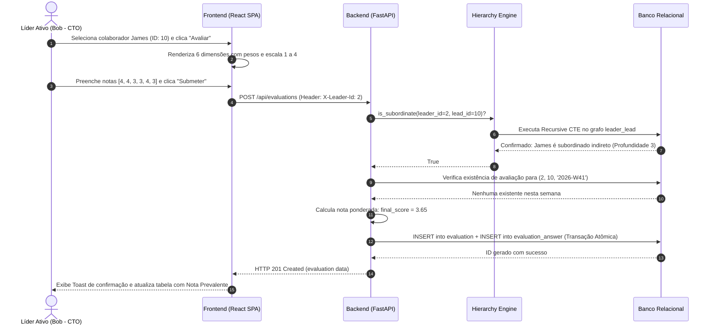

# Documentos Pré-Desenvolvimento & Engenharia de Requisitos

Este documento consolida os artefatos de planejamento, histórias de usuário, critérios de aceite, casos de uso e diagramas conceituais concebidos para guiar o desenvolvimento da plataforma.

---

## 1. Personas e Cenários de Uso

### Persona 1: Alice Hartman (CEO - Topo da Hierarquia)
- **Objetivo**: Ter visibilidade de toda a organização (19 colaboradores), acompanhar os ciclos de avaliações dos diretores e avaliar seus reportes executivos diretos (Bob, Carol, Frank, Tina).
- **Necessidade**: Saber quais funcionários estão sendo avaliados e garantir que avaliações estratégicas de nível C tenham o devido peso.

### Persona 2: David Okafor (Engineering Manager - Liderança Intermediária)
- **Objetivo**: Avaliar seus liderados diretos (Henry Patel e Liam Johansson) e também poder calibrar e avaliar os engenheiros sob supervisão de Henry (James e Karen).
- **Necessidade**: Poder avaliar os subordinados dos seus subordinados e verificar o feedback dado pelo líder direto, prevalecendo a visão de gerência quando aplicável.

### Persona 3: Henry Patel (Senior Software Engineer / Tech Lead - Liderança Operacional)
- **Objetivo**: Avaliar semanalmente o trabalho técnico e comportamental de James e Karen.
- **Necessidade**: Ter a certeza de que James e Karen não têm acesso às suas notas antes de reuniões 1-on-1, e que ele próprio não tem acesso à avaliação que David fez sobre ele.

---

## 2. Histórias de Usuário & Critérios de Aceite (Gherkin)

### US01: Avaliação de Subordinados Diretos e Indiretos
> **Como** Líder corporativo (ex: David Okafor ou Bob Sinclair),  
> **Quero** visualizar e avaliar todos os colaboradores da minha árvore hierárquica (diretos e indiretos),  
> **Para que** eu possa acompanhar e calibrar o desempenho de todo o meu time.

**Critérios de Aceite:**
- **Dado** que estou autenticado como David Okafor (Eng Manager),
- **Quando** acesso o painel de liderados,
- **Então** devo ver Henry Patel (direto), Liam Johansson (direto), James Watanabe (indireto via Henry) e Karen Oliveira (indireto via Henry).
- **E** posso submeter avaliação para qualquer um dos 4 colaboradores.

---

### US02: Frequência Semanal e Imutabilidade das Respostas
> **Como** Líder,  
> **Quero** enviar minha avaliação semanal para um liderado com notas de 1 a 4 e comentários,  
> **Para que** o histórico de desempenho seja consolidado de forma fidedigna e sem alterações posteriores.

**Critérios de Aceite:**
- **Dado** que submeti com sucesso uma avaliação para James na semana `2026-W41`,
- **Quando** tento enviar uma segunda avaliação para James na mesma semana `2026-W41`,
- **Então** o sistema rejeita a operação com erro HTTP 409 (Conflict).
- **E** não existe rota de `PUT` ou `PATCH` para editar notas previamente salvas.

---

### US03: Prevalência Hierárquica nas Notas ("Respeitando sempre a maior hierarquia")
> **Como** Organização,  
> **Queremos** que, caso múltiplos líderes avaliem o mesmo colaborador na mesma semana, a avaliação do líder de maior hierarquia prevaleça como a nota oficial,  
> **Para que** as decisões executivas e de gestão sênior tenham precedência institucional.

**Critérios de Aceite:**
- **Dado** que Henry (Nível 4) avaliou James com nota 3.30 na semana `2026-W41`,
- **E** David (Nível 3 - superior de Henry) também avaliou James com nota 3.65 na semana `2026-W41`,
- **Quando** qualquer líder autorizado consulta a avaliação oficial de James para a semana `2026-W41`,
- **Então** a nota oficial prevalente exibida é **3.65** (avaliador David Okafor).
- **E** no histórico detalhado ambas as avaliações constam registradas, com a de David marcada como `Prevalente`.

---

### US04: Privacidade Estrita e Bloqueio de Visualização
> **Como** Colaborador,  
> **Quero** que as avaliações sejam visíveis exclusivamente para os líderes hierarquicamente superiores,  
> **Para que** seja preservada a confidencialidade e segurança psicológica.

**Critérios de Aceite:**
- **Dado** que estou selecionado como Bob Sinclair (CTO),
- **Quando** tento consultar `/api/evaluations/employee/2` (minha própria avaliação),
- **Então** o sistema responde com **HTTP 403 Forbidden**.
- **Quando** tento consultar `/api/evaluations/employee/3` (minha colega/par Carol Nguyen - CFO),
- **Então** o sistema responde com **HTTP 403 Forbidden**.
- **Quando** tento consultar `/api/evaluations/employee/1` (minha superior Alice Hartman - CEO),
- **Então** o sistema responde com **HTTP 403 Forbidden**.

---

## 3. Diagrama de Sequência UML (Fluxo de Avaliação e Prevalência)

---

## 4. Architecture Decision Records (ADR)

### ADR-01: Utilização de Recursive CTE para Resolução Hierárquica
- **Contexto**: A organização é modelada como um grafo acíclico direcionado de liderança através da tabela `leader_lead`.
- **Decisão**: Empregar queries recursivas (`WITH RECURSIVE`) diretamente no banco de dados.
- **Consequência**: Execução em sub-milissegundos, com uma única ida ao banco, parametrizada contra injeção de SQL e compatível com PostgreSQL e SQLite.

### ADR-02: Identificação do Líder Ativo via Cabeçalho `X-Leader-Id` e LocalStorage
- **Contexto**: O desafio dispensou um sistema de login completo (OAuth/JWT), exigindo uma forma ágil e documentada de trocar entre líderes.
- **Decisão**: Utilizar o header HTTP `X-Leader-Id` injetado pelo client a partir do `localStorage` (com fallback para Cookie `leader_id`).
- **Consequência**: Permite testes imediatos na UI com 1 clique no seletor de liderança, sem comprometer as validações no backend, que validam a existência do ID e todas as regras de segurança a cada request.
